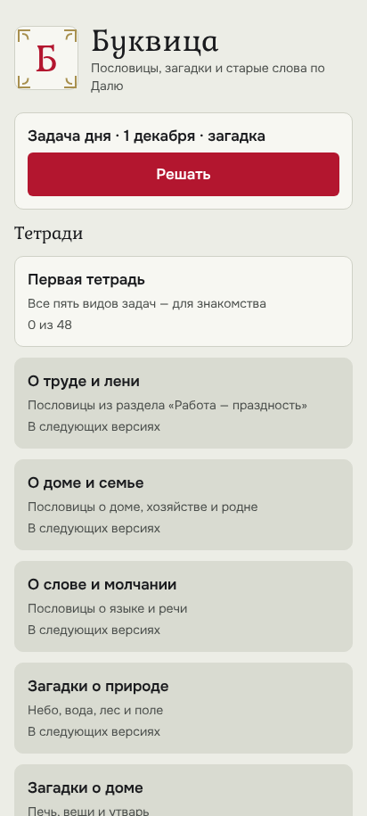
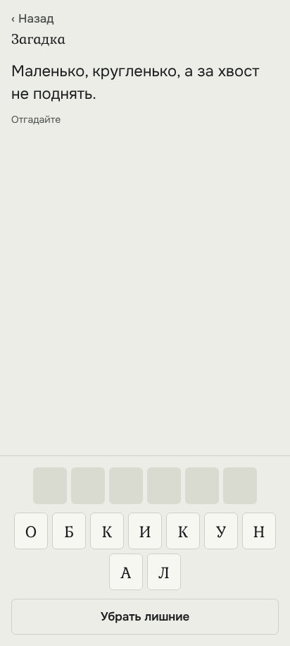
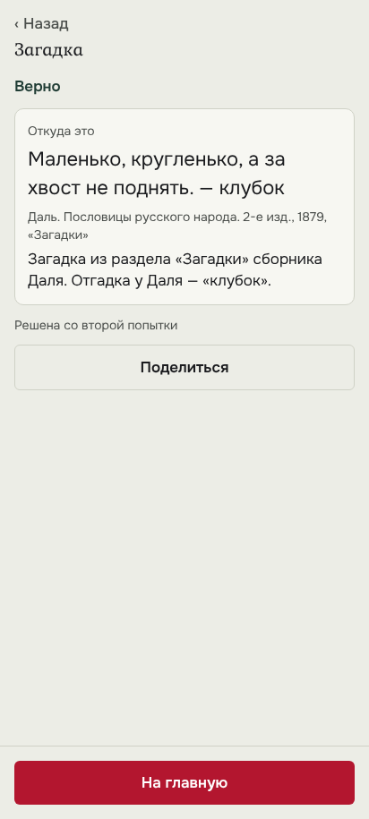

# Вид: лист стиля

Правила — устав, [ADR 0023](https://github.com/Nefeste/gornitsa/blob/main/adr/0023-graphics.md) и
[`brand/README.md`](https://github.com/Nefeste/gornitsa/blob/main/brand/README.md); вид игры — [`08-game-design.md`](08-game-design.md),
«Вид»; SVG без Skia — ADR [0004](adr/0004-expo-no-skia.md). Как выполнены правила — [`02-architecture.md`](02-architecture.md),
«Графика (ADR 0023 устава)».

## Какой вид

**Страница старой книги, а не игровой автомат.** Светлая льняная бумага, чёрные чернила, одна красная буквица —
как заглавная буква в рукописи. Ничего не мигает и не блестит; радует сама пословица.

- **Силуэты:** прямоугольные карточки и плитки со скруглением 6–10 точек; плитка буквы — как набор наборщика.
- **Палитра:** только токены брендбука студии — лён (фон), бумага (карточки, плитки), чернила (текст), кумач
  (буквица, главная кнопка, скрытое слово), ель (верно, кружки итога), льняная нить (уголки буквицы — только
  украшение). Своих цветов нет.
- **Шрифты студии:** Kurale — заголовки, буквица и буквы на плашках (рукописная старинная форма); Onest — условие и всё
  остальное. Условие — 22 точки, плашки — 48 точек (`08-game-design.md`, «Вид»).
- **Свет и камера:** нет — плоская страница, без теней и градиентов.
- **Движение:** экран меняется по касанию; встряхивание ряда в 0.1 — рамка кумачом без движения. Движение появится
  только вместе с «Меньше движения».
- **Тёмная тема и «ещё крупнее»** — по `08-game-design.md`, с 0.2; токены тёмной темы — в брендбуке.

## Чего в виде нет

- Картинок к пословицам, персонажей, «народного» лубка поверх текста — пословица и есть картинка.
- Растровой графики, генераторов изображений (ADR устава 0012).
- Конфетти, вспышек, звёзд за верный ответ, тряски за неверный.

## Эталонные кадры

**Предложено, ждёт одобрения владельца в PR** (`uprava#76`: кадры предлагает агент, владелец одобряет или меняет).
Снимки — сценарий в браузере (`EXPO_OFFLINE=1 npm run export:web && npm run e2e`, `?date=2026-12-01`, 412 × 915
точек): файлы `tools/e2e/out/01-home.png`, `02-daily-task.png`, `03-daily-source.png` копируются сюда как есть. Каждый
новый экран и рисунок сверяется с ними.

| Кадр | Почему этот |
|---|---|
|  | главная — тон всей игры: буквица, бумага, задача дня с одной красной кнопкой, тетради |
|  | главный жест — ряд букв в нижней половине экрана, условие крупно сверху, одна подсказка по порядку |
|  | «Откуда это»: полный текст, источник, строка о значении — то, ради чего игра; «Поделиться» без ответа |

## Иконка (к 0.2)

Буквица «Б» кумачом на бумаге в рамке льняной нити — та же, что на первом экране, нарисованная скриптом (паспорт —
скрипт, версия, SHA-256), в единицах адаптивной иконки Android, как у «Нард».
